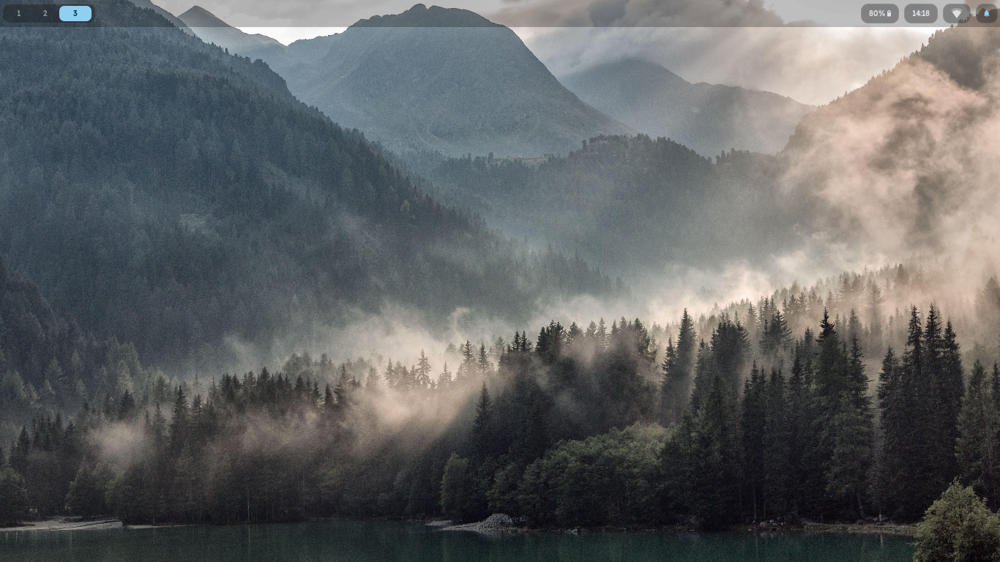
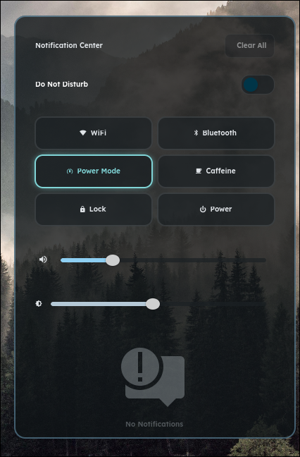

# Hyprland dotfiles

Konfigurasi Hyprland (format **Lua**) dengan tema warna otomatis dari wallpaper (matugen).
Dibuat di **ThinkPad L480 + CachyOS**, diuji dengan Hyprland 0.56.2 dan hyprpaper 0.8.4.

<!-- Taruh screenshot di docs/screenshots/ dengan nama di bawah ini -->



## Isi

| Komponen | Fungsi |
|---|---|
| **Hyprland** | Window manager, config modular Lua (`hypr/.config/hypr/config/*.lua`) |
| **hyprpaper** | Wallpaper (hyprpaper 0.8, diatur lewat `set-wallpaper.sh`) |
| **hypridle / hyprlock** | Idle bertahap: redup 150 dtk, kunci 240 dtk, layar mati 300 dtk, suspend 360 dtk |
| **waybar** | Bar atas: workspaces, baterai, jam (kalender saat hover), tray, ikon notifikasi |
| **swaync** | Notifikasi + control center (WiFi, Bluetooth, Power Mode, Caffeine, Lock, Power) |
| **swayosd** | OSD volume dan kecerahan |
| **rofi** | Launcher, picker wallpaper, clipboard (cliphist), menu power |
| **matugen** | Warna tema dari wallpaper ke waybar, swaync, swayosd, kitty, fastfetch |
| **cam-watch** | Notifikasi kalau ada proses yang membuka kamera |

## Keybind (`SUPER` = tombol Windows)

| Tombol | Aksi |
|---|---|
| `SUPER + Enter` | Terminal (kitty) |
| `SUPER + Space` / `SUPER + Shift + D` | Launcher (rofi) / jalankan perintah |
| `SUPER + E` / `B` / `C` | Thunar / Firefox / VSCodium |
| `SUPER + Q` | Tutup jendela |
| `SUPER + Shift + Q` | Keluar Hyprland (ada konfirmasi) |
| `SUPER + L` | Kunci layar |
| `SUPER + N` | Buka/tutup control center |
| `SUPER + V` | Riwayat clipboard |
| `SUPER + W` | Pilih wallpaper (atau acak) |
| `SUPER + D` / `F` | Maximize / fullscreen |
| `SUPER + Alt + Space` | Floating on/off |
| `SUPER + P` | Pin jendela |
| `SUPER + panah` atau `H J K` | Pindah fokus |
| `SUPER + Shift + panah` | Pindahkan jendela |
| `SUPER + Ctrl + panah` | Resize jendela |
| `SUPER + 1..9, 0` | Pindah workspace |
| `SUPER + Shift + 1..9, 0` | Kirim jendela ke workspace |
| `SUPER + Tab` / `Shift + Tab` | Workspace berikutnya / sebelumnya |
| `SUPER + scroll` | Geser workspace |
| `SUPER + drag kiri / kanan` | Pindahkan / resize jendela |
| `Shift + SUPER + S` | Screenshot area (disimpan dan disalin) |
| `Print` | Screenshot layar penuh |
| Tombol volume, mic, kecerahan, media | Lewat swayosd dan playerctl |

## Instalasi

Prasyarat: Hyprland dengan dukungan config Lua (diuji di 0.56.2). Program yang dibutuhkan
(`install.sh` memeriksa dan memberi peringatan kalau ada yang kurang, tidak meng-install apa pun):

```
Hyprland hyprctl hyprpaper hypridle hyprlock waybar swaync swaync-client
swayosd-server swayosd-client rofi matugen cliphist wl-copy wl-paste
brightnessctl playerctl powerprofilesctl notify-send grim slurp
```
Opsional: `kitty fastfetch thunar firefox codium nm-applet fuser` dan tema kursor `Breeze_Light`.

```bash
git clone https://github.com/FoolInKernel/dotfiles.git ~/Projects/dotfiles
cd ~/Projects/dotfiles
./install.sh --dry-run      # lihat dulu apa yang akan berubah
./install.sh --reload       # pasang, lalu reload Hyprland, waybar, swaync
```

`install.sh` **menyalin** file (tanpa stow, tanpa symlink) ke `~/.config` dan `~/.local/bin`:
- Folder yang sudah ada dibackup ke `~/.dotfiles-backup/<waktu>/` sebelum ditimpa.
- File generated (`colors.css`, `generated/`, `power-mode.css`, `hyprpaper.conf`) tidak pernah ditimpa.
- Aman dijalankan berulang kali. Pasang sebagian saja: `./install.sh hypr waybar`.
- Perubahan di repo baru berlaku setelah `./install.sh` dijalankan lagi.

Setelah pasang:
1. Taruh wallpaper di `~/Pictures/walls`, lalu tekan `SUPER + W` (atau
   `~/.config/hypr/set-wallpaper.sh /path/ke/gambar.jpg`). Ini membuat warna tema dan `hyprpaper.conf`.
2. Cek config: `hyprctl configerrors`.

## Tema warna (matugen)

`set-wallpaper.sh` mengatur wallpaper lewat IPC hyprpaper, lalu menjalankan `matugen` yang menghasilkan
warna untuk waybar, swaync, swayosd, kitty, dan fastfetch. Bar, control center, dan OSD selalu punya
fallback `colors.default.css`, jadi tidak blank sebelum matugen pernah dijalankan.

Catatan penting kalau kamu sudah punya setup sendiri:
- **fastfetch**: template matugen menulis ke `~/.config/fastfetch/config.jsonc` dan **menimpa** config-mu
  setiap ganti wallpaper. Hapus blok `[templates.fastfetch]` di `matugen/.config/matugen/config.toml` kalau tidak mau.
- **kitty**: repo ini tidak membawa `kitty.conf`. Agar warna ikut berubah, tambahkan di `kitty.conf`:
  ```
  include colors-matugen.conf
  allow_remote_control socket-only
  listen_on unix:/tmp/kitty-socket
  ```

## Struktur

```
hypr/.config/hypr/       hyprland.lua, config/*.lua, hypridle.conf, hyprlock.conf,
                         set-wallpaper.sh, scripts/ (picker wallpaper, clipboard, konfirmasi keluar)
waybar/.config/waybar/   config.jsonc, style.css, scripts/ (power menu, power profile, caffeine)
swaync/.config/swaync/   config.json, style.css
swayosd/.config/swayosd/ style.css
rofi/.config/rofi/       config.rasi dan tema
matugen/.config/matugen/ config.toml dan template
local-bin/.local/bin/    cam-watch
mako/.config/mako/       arsip (sudah diganti swaync, tidak dipasang otomatis)
install.sh               pemasang (menyalin file)
docs/                    catatan audit dan screenshot
```

## Spesifik mesin (ubah kalau perangkatmu beda)

- `hypr/.config/hypr/config/monitors.lua`: `eDP-1` 1366x768 (layar ThinkPad L480).
- `hypr/.config/hypr/config/inputs.lua`: layout keyboard `us`, pengaturan touchpad.
- `hypr/.config/hypr/config/variables.lua`: aplikasi default (kitty, thunar, firefox, codium, rofi).
- Backlight dan perintah daya mengasumsikan `brightnessctl` dan `power-profiles-daemon`.

## Backup

Repo ini sekaligus backup online dotfiles. Alur yang disarankan: edit di repo, lalu `./install.sh`,
commit, dan `git push`. Wallpaper tidak ikut tersimpan (gambar di-ignore oleh `.gitignore`).
